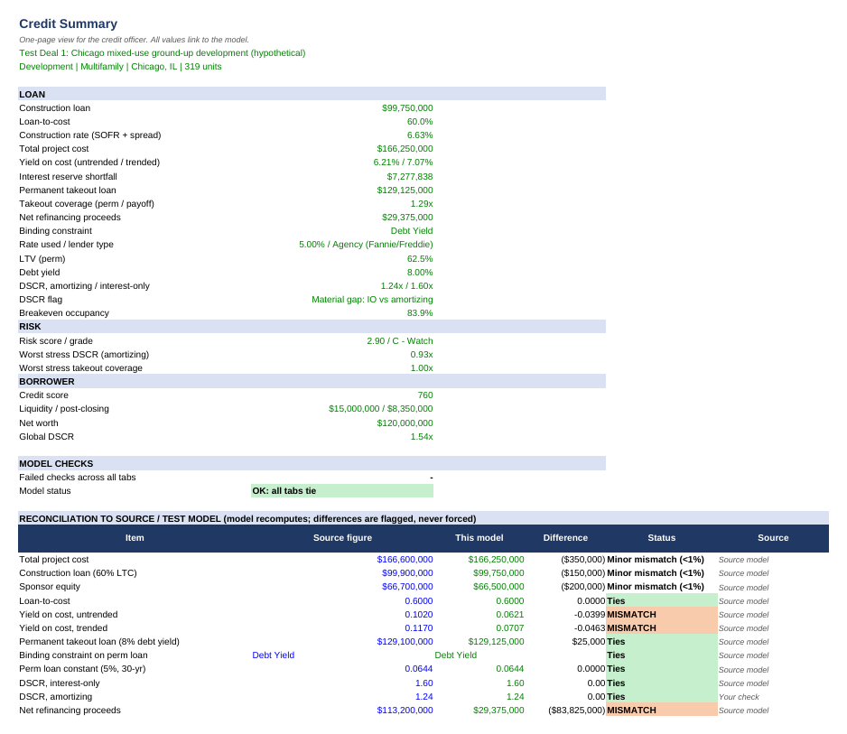
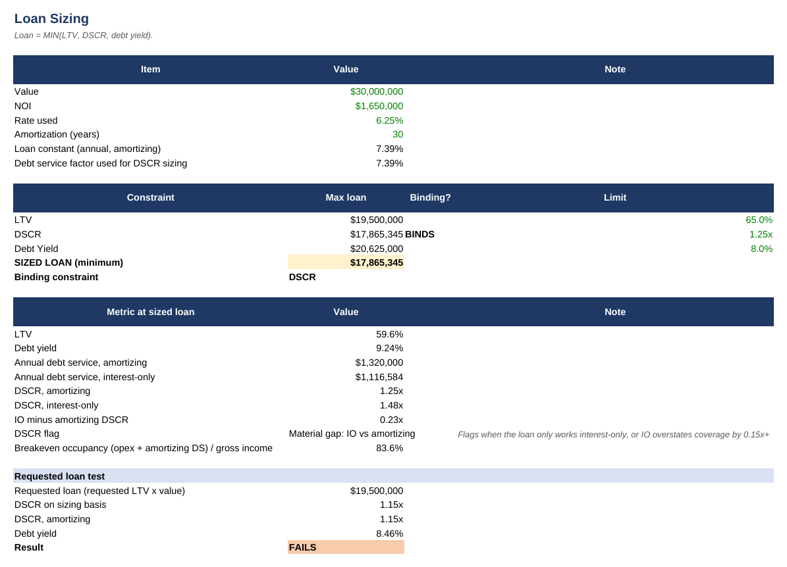
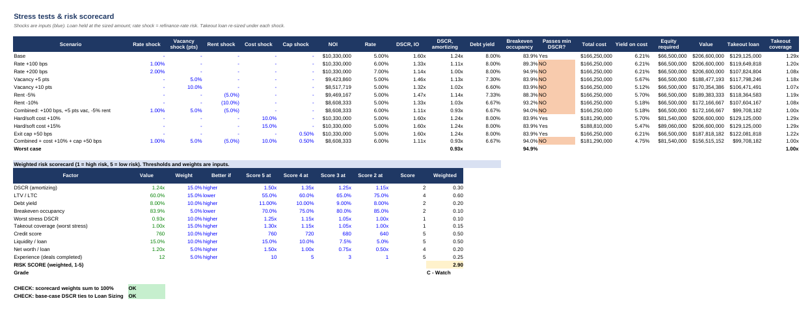

# CRE Credit Dashboard

[](https://github.com/Medinathecreator/Real-Estate-Credit-Dashboard/actions/workflows/tests.yml)
<!-- Live demo: replace the line below with your Streamlit Community Cloud link, then delete this comment -->
<!-- **[Live demo](https://YOUR-APP.streamlit.app)** -->

A lender's-eye view of a commercial real estate loan. Enter a property and borrower; the dashboard sizes and qualifies the loan, stress-tests it, scores the risk, prices it by lender type, shows how it fits a personal debt schedule, and builds an auditable Excel model with **live formulas**.

## What it does

| | |
|---|---|
| **1. Loan sizing** | Loan = MIN(max LTV or LTC, min DSCR, min debt yield), with the binding constraint highlighted. DSCR shown both interest-only and amortizing, with a flag when they tell different stories. A requested loan is tested against all three limits. |
| **2. Risk** | Stress tests on rate, vacancy, rent, and (for development) hard/soft costs and exit cap. Each shows DSCR, debt yield and breakeven occupancy. A weighted 10-factor risk scorecard ends in a grade from A to E. |
| **3. Pricing** | SOFR and 2/5/10-year Treasuries from FRED, plus a spread grid by lender type (agency, bank, CMBS, debt fund, DSCR loan, construction) and leverage band. **Spreads are labeled assumptions** with their sources. |
| **4. Excel model** | Tabs: Credit Summary, Inputs, NOI, Sources & Uses, Loan Sizing, Pricing, Amortization, (Construction), Stress Tests, Debt Schedule. Blue = input, black = formula, green = link. Every tab has an OK/CHECK row. |
| **5. Debt schedule** | Your personal debts plus the new loan: DTI, global DSCR, post-closing liquidity, contingent liability, and a 10-year balance projection. |

## Screenshots

<!-- App screenshots: save them in docs/screenshots/ with these names, then delete the comment markers around this block.
**Dashboard: loan sizing (Test Deal 2)**


**Dashboard: construction draw and takeout test (Test Deal 1)**

-->

**Excel Credit Summary (Test Deal 1).** One-page view, plus the reconciliation that flags where the source model doesn't tie.


**Excel Loan Sizing (Test Deal 2).** Three constraints; DSCR binds, and the requested 65% LTV loan fails.


**Excel Stress Tests and risk scorecard (Test Deal 1).**


**Two loan paths**
- **A. Stabilized acquisition / refi:** permanent debt sized on purchase price or value.
- **B. Ground-up development:** construction loan sized on loan-to-cost, with a monthly draw schedule (equity first). It also covers the interest reserve, with lease-up NOI paying interest first, and a **takeout test**: does the permanent loan cover the construction payoff?

**Validation rule:** the tool recomputes everything from the inputs. Figures from your source or test model go in a deal's `expected` list. The tool reports **Ties / Minor mismatch / MISMATCH** and never adjusts its math to match.

## Run on Replit
1. Create a new **Python** Repl and upload this folder's contents, so `app.py` is at the top level.
2. Press **Run**. `.replit` starts Streamlit on port 8080, and Replit installs `requirements.txt`.
3. Optional: add a free FRED API key (fred.stlouisfed.org → My Account → API Keys) in **Tools → Secrets** as `FRED_API_KEY`.
   - Without a key, the app uses FRED's public CSV download.
   - If FRED can't be reached, it uses stored benchmark values and labels them "fallback".

## Test deals (in `deals/`)

| Deal | Result |
|---|---|
| **Test Deal 2: Nashville acquisition** | Reproduces every expected number from the inputs. Loan at 65% LTV = $19.5M at **1.15x DSCR**, which fails the 1.25x minimum. **DSCR binds**, and the loan sizes down to **$17.87M (59.6% LTV, 9.24% debt yield)** with a 7.39% constant. |
| **Test Deal 1: Chicago development** | The perm takeout ties: **$129.1M** at an 8% debt yield (debt yield binds), with **1.60x interest-only / 1.24x amortizing** DSCR. The tool flags four problems in the source model, listed below. |

The four flags on Deal 1:
1. **Total cost** recomputes to **$166.25M**, not $166.6M, so the loan ($99.75M) and equity ($66.5M) differ slightly too.
2. **Yield on cost** is **6.2% untrended / 7.1% trended** on total cost, not 10.2% / 11.7%. The source figures match NOI ÷ *loan* instead.
3. **Net refinancing proceeds** recompute to **$29.4M** (perm minus payoff), not $113.2M.
4. Under the assumed 30-month build and 18-month lease-up, the **interest reserve** needs about $8.5M against about $1.25M budgeted.

The assumptions used for inputs the source models didn't give (opex ratio, timing, sample borrower) are listed in each deal file and on the Inputs tab.

## Tests
Every push runs the GitHub Actions workflow (`.github/workflows/tests.yml`). It runs each deal through the engine, builds its Excel model, recalculates the workbook in LibreOffice, and checks that Excel's live formulas match the Python engine: loan size, binding constraint, DSCRs, debt yield, interest reserve, takeout coverage, risk score and global DSCR. It also checks for 0 formula errors and an OK on every tab's check row. The generated Excel models are saved as a downloadable artifact on each run.

To run it locally (needs LibreOffice for the recalculation step):
```bash
python tests/test_deals.py tests/recalc.py
```

## Project layout
```
app.py              Streamlit dashboard
cre/engine.py       all calculations (sizing, draws, stress, scorecard, debt schedule, validation)
cre/pricing.py      FRED benchmarks + spread grid (assumptions, with sources)
cre/excel.py        Excel generator (openpyxl, live formulas, defined names, check rows)
deals/*.json        test deals + starter deals (edit or add your own)
tests/test_deals.py end-to-end test and Excel/Python tie-out
tests/recalc.py     LibreOffice recalculation used by the tests
.github/workflows/  GitHub Actions: runs the tests on every push
docs/screenshots/   images used in this README
```

## Limitations
- Spreads are compiled from public market commentary (Nov 2026) and should be refreshed. They are not lender quotes.
- The construction draw schedule uses a flat SOFR forward and straight-line or S-curve draws. The Excel Construction tab's row count is fixed when the file is generated.
- Breakeven and stress tests need an income/expense split. In "NOI only" mode that split comes from an assumed opex ratio.
- Educational project; not lending advice.
